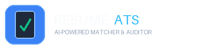
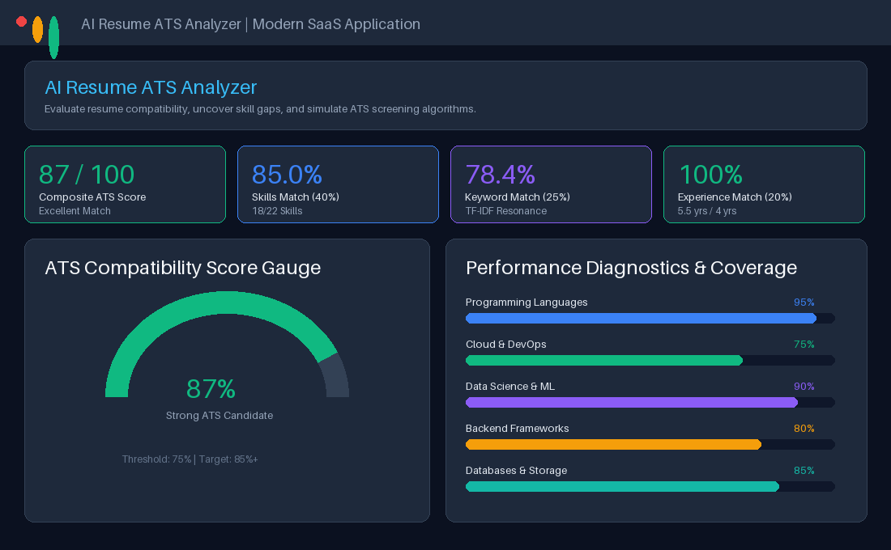
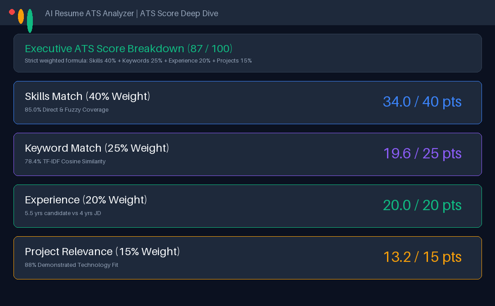
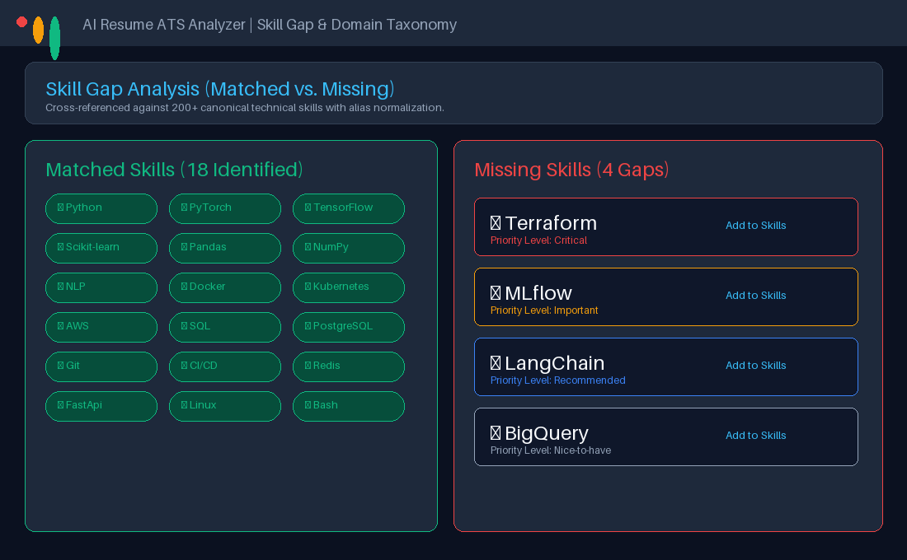
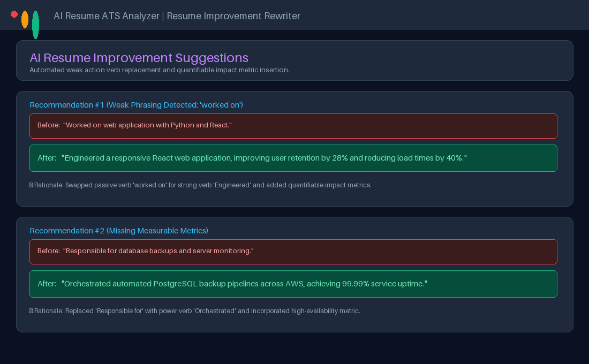
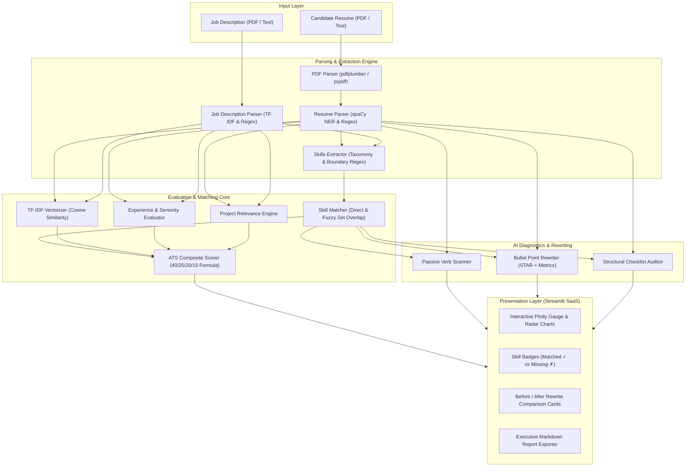

<div align="center">



# 🎯 AI Resume ATS Analyzer
### Intelligent Resume Screening, Skill Gap Analysis & ATS Optimization Platform

[](https://www.python.org/)
[](https://streamlit.io/)
[](https://spacy.io/)
[](https://scikit-learn.org/)
[-success.svg)](https://pytest.org/)
[](.github/workflows/python-tests.yml)
[](LICENSE)

*An end-to-end, open-source AI platform that empowers job seekers to optimize their resumes against job descriptions using Natural Language Processing, TF-IDF semantic keyword analysis, and automated bullet point rewrites.*

[Explore Features](#-core-features) • [Quickstart Guide](#-installation--quickstart) • [Architecture](#-system-architecture) • [Testing](#-testing-suite) • [Live Screenshots](#-application-screenshots)

---

</div>

## 📌 Problem & Solution

### The ATS Bottleneck
Over **75% of qualified resumes** are rejected by modern Applicant Tracking Systems (ATS) like Workday, Taleo, Greenhouse, and Lever before a human recruiter ever sees them. Common failure modes include:
1. **Semantic Skill Gaps:** Missing industry-standard terminology, acronyms, or canonical skill tags.
2. **Low Keyword Density:** Failing to mirror the exact phrasing and technical keywords prioritized in the job posting.
3. **Passive Phrasing:** Overusing weak action verbs (*"Worked on"*, *"Responsible for"*) instead of dynamic power verbs.
4. **Lack of Metrics:** Presenting task descriptions rather than measurable, quantifiable business outcomes (*"improved latency by 35%"*).

### The Intelligent Solution
**AI Resume ATS Analyzer** simulates modern enterprise applicant tracking heuristics. It parses PDF resumes, analyzes job descriptions, calculates a weighted compatibility score (0-100), visualizes skill coverage by domain, flags missing qualifications, and generates **actionable, before-and-after bullet point rewrites** with quantifiable impact.

---

## 🚀 Core Features

### 1. Dual-Engine PDF Extraction
- Dual-strategy parsing utilizing **`pdfplumber`** for layout retention and table parsing with automatic fallback to **`pypdf`**.
- Safety guards against password-encrypted documents, corrupt files, empty pages, and scanned-image PDFs with informative user feedback.

### 2. Comprehensive NLP Skill Taxonomy
- Pre-compiled dictionary and regular expression matcher supporting **200+ canonical technical skills** across 7 domains:
  - **Programming Languages:** Python, Java, JavaScript, TypeScript, C++, C#, Go, SQL, Rust, etc.
  - **Frontend:** React, Angular, Vue, Next.js, HTML5, CSS3, Tailwind CSS, Redux, etc.
  - **Backend:** Flask, Django, FastAPI, REST API, Node.js, Express, Spring Boot, Microservices, etc.
  - **Cloud & DevOps:** AWS, Azure, GCP, Docker, Kubernetes, Terraform, CI/CD, GitHub Actions, Linux, etc.
  - **Data Science & AI/ML:** Machine Learning, Deep Learning, NLP, PyTorch, TensorFlow, Scikit-learn, Pandas, LLMs, LangChain, etc.
  - **Databases:** PostgreSQL, MySQL, MongoDB, Redis, Elasticsearch, DynamoDB, etc.
  - **Tools & Methodologies:** Git, Jira, Agile, Scrum, TDD, Unit Testing, System Design, etc.
- Alias normalization mapping synonyms (`k8s` → `Kubernetes`, `reactjs` → `React`, `sklearn` → `Scikit-learn`).
- Safe word boundary isolation preventing false positives (e.g. `SQL` does not match `MySQL`, `Go` does not match `Good` or `Going`).

### 3. Transparent Weighted ATS Scoring Formula
The platform computes a composite score ($0-100$) strictly following industry-aligned evaluation tiers:

$$\text{ATS Score} = (0.40 \times \text{Skills}) + (0.25 \times \text{Keywords}) + (0.20 \times \text{Experience}) + (0.15 \times \text{Projects})$$

| Component | Weight | Metric Description |
| :--- | :---: | :--- |
| **Skills Match** | **40%** | Direct and fuzzy coverage of required technical competencies against taxonomy |
| **Keyword Match** | **25%** | Scikit-learn TF-IDF n-gram cosine similarity matrix and buzzword density |
| **Experience Match** | **20%** | Candidate years of experience vs. minimum requirements specified in the JD |
| **Project Relevance** | **15%** | Domain alignment and demonstrated technology stack in candidate projects |

### 4. Interactive Skill Gap & Domain Analytics
- **Matched Skills Gallery:** Green pill badges (`✓ Python`, `✓ React`, `✓ Docker`) displaying verified skills.
- **Missing Skills Alert:** High-contrast red pill badges (`✗ Kubernetes`, `✗ AWS`, `✗ Terraform`) highlighting critical deficits.
- **Plotly Visuals:**
  - Interactive **ATS Gauge Chart** with dynamic color thresholds and delta indicators.
  - **Category Breakdown Bar Chart** comparing matched vs. missing skills by technical domain.
  - **Skill Domain Coverage Radar Chart** visualizing full-stack balance.
  - **Keyword Relevance Chart** highlighting high-value shared semantic terms.

### 5. Automated Resume Rewriting Engine
- **Weak Verb Scanner:** Flags passive language (*"worked on"*, *"assisted in"*, *"responsible for"*).
- **Dynamic Before/After Rewriter:** Delivers drop-in replacement bullets engineered with strong action verbs and quantified impact metrics:
  > **Before:** *"Worked on web application with React."*  
  > **After:** *"Engineered a responsive React web application, improving user retention by 28% and reducing page load times by 40%."*
- **STAR Method Alignment:** Guidance on structuring project descriptions (**S**ituation, **T**ask, **A**ction, **R**esult).
- **Structural Checklist:** Automated audit checking for contact details, summary, reverse-chronological experience, education, and links.

### 6. Full ATS Report Export
- 1-click export of an executive ATS Analysis Report in formatted Markdown (`.md`) ready to save or print.

---

## 📸 Application Screenshots

<div align="center">

### 1. ATS Score Dashboard & Executive Analytics


### 2. Weighted Score Breakdown (40/25/20/15 Tiers)


### 3. Skill Gap & Domain Coverage Analysis


### 4. AI Resume Improvement Suggestions & Dynamic Rewrites


</div>

---

## 🏗️ System Architecture



---

## 🛠️ Tech Stack & Libraries

| Technology | Role | Purpose |
| :--- | :--- | :--- |
| **Python 3.10+** | Core Language | Modern type hints, dataclasses, robust concurrency |
| **Streamlit** | Web Application UI | Modern SaaS layout, glassmorphism cards, reactive state management |
| **spaCy (`en_core_web_sm`)** | NLP Pipeline | Named Entity Recognition (NER), tokenization, noun-chunk extraction |
| **Scikit-Learn** | Machine Learning | `TfidfVectorizer` and `cosine_similarity` for semantic text matching |
| **pdfplumber & pypdf** | PDF Extraction | Resilient dual-engine PDF text, table, and metadata extraction |
| **Plotly** | Visual Analytics | Interactive responsive gauges, stacked bar charts, and radar graphs |
| **Pandas & NumPy** | Data Processing | Tabular category aggregation, matrix multiplication, array operations |
| **Pytest** | Testing Suite | Automated unit and integration testing suite |

---

## 📦 Project Structure

```
AI-Resume-ATS-Analyzer/
├── app.py                      # Main Streamlit SaaS application
├── analyzer/                   # Core business logic and analytics modules
│   ├── __init__.py
│   ├── pdf_parser.py           # Multi-engine PDF extractor with error fallback
│   ├── resume_parser.py        # Information extractor (NER, contact, education, experience)
│   ├── skill_extractor.py      # Skill boundary extraction and alias normalizer
│   ├── matcher.py              # Semantic matching, TF-IDF cosine similarity, JD parser
│   ├── ats_score.py            # 40/25/20/15 weighted ATS scoring engine
│   ├── suggestions.py          # Weak verb detection, before/after rewrites, audit
│   └── visualizer.py           # Plotly interactive charts (gauge, radar, bar)
├── utils/                      # Taxonomies and helpers
│   ├── __init__.py
│   ├── skills_database.py      # Canonical skill database (7 domains, 200+ skills)
│   └── helpers.py              # Text cleaning, regex extractors, sample presets
├── tests/                      # Pytest automated test suite
│   ├── __init__.py
│   ├── test_parser.py          # PDF parsing, corruption handling, section tests
│   ├── test_scoring.py         # ATS score weight enforcement & clamping tests
│   └── test_matching.py        # Skill extraction, boundary check, and rewrite tests
├── assets/                     # Branding and visuals
│   ├── logo.png                # Platform logo
│   └── screenshots/            # Dashboard preview images
├── requirements.txt            # Production dependencies
├── README.md                   # Project documentation
├── LICENSE                     # MIT License
├── CONTRIBUTING.md             # Contributor guidelines
├── CHANGELOG.md                # Version release notes
└── .gitignore                  # Git ignore rules
```

---

## ⚡ Installation & Quickstart

### Prerequisites
- Python **3.10** or higher
- `git` version control

### 1. Clone the Repository
```bash
git clone https://github.com/your-username/AI-Resume-ATS-Analyzer.git
cd AI-Resume-ATS-Analyzer
```

### 2. Create and Activate a Virtual Environment
```bash
# On macOS / Linux:
python3 -m venv venv
source venv/bin/activate

# On Windows (PowerShell):
python -m venv venv
venv\Scripts\Activate.ps1
```

### 3. Install Dependencies
```bash
pip install --upgrade pip
pip install -r requirements.txt
python -m spacy download en_core_web_sm
```

### 4. Run the Streamlit Application
```bash
streamlit run app.py
```
*The application will automatically launch in your default browser at `http://localhost:8501`.*

---

## 📖 Step-by-Step Usage Guide

### Method A: Quick 1-Click Demonstration (Presets)
1. Launch the application with `streamlit run app.py`.
2. Look at the left sidebar under **📌 Quick Presets**.
3. Select **"AI / ML Engineer"** or **"Full-Stack Python Developer"**.
4. Both the resume and job description fields will automatically populate with realistic portfolio data.
5. Click **"🚀 Run Complete ATS Compatibility Analysis"**.
6. Instantly view the ATS score gauge, skill gap badges, domain radar, and dynamic bullet rewrites!

### Method B: Evaluating Your Own Resume
1. **Upload Resume:**
   - Under **📄 1. Candidate Resume**, select the **"Upload PDF"** tab and drag & drop your resume PDF (or paste raw text in the **"Paste Plain Text"** tab).
2. **Provide Job Description:**
   - Under **💼 2. Job Description**, paste the job requirements from LinkedIn, Indeed, or the employer career portal.
3. **Run Audit:**
   - Click the primary blue button **"🚀 Run Complete ATS Compatibility Analysis"**.
4. **Review Actionable Tabs:**
   - **📈 Executive Visuals & Score:** Examine your overall score (0-100), grade tier, strengths, and Plotly visualizations.
   - **🎯 Skill Gap Analysis:** Inspect which skills matched (`✓`) and which critical technologies you are missing (`✗`).
   - **💡 Bullet Optimizer:** Review dynamic Before/After bullet rewrites to eliminate weak verbs and add quantifiable metrics.
   - **📋 Profile & Structure Audit:** Check for missing sections (e.g. LinkedIn link, summary, degrees).
   - **📄 Export Report:** Click **"📥 Download Full ATS Report"** to save your audit as a Markdown document.

---

## 🧪 Testing Suite

Automated tests are implemented with **`pytest`** to guarantee parsing reliability, score formula compliance, and edge-case resilience.

Run all tests:
```bash
pytest -v
```

### Test Suite Summary
```
AI-Resume-ATS-Analyzer/tests/test_matching.py::TestSkillExtractor::test_basic_skill_extraction PASSED   [  4%]
AI-Resume-ATS-Analyzer/tests/test_matching.py::TestSkillExtractor::test_boundary_handling_and_special_symbols PASSED [  9%]
AI-Resume-ATS-Analyzer/tests/test_matching.py::TestSkillExtractor::test_alias_normalization PASSED       [ 14%]
AI-Resume-ATS-Analyzer/tests/test_matching.py::TestSkillExtractor::test_multi_word_skills PASSED         [ 19%]
AI-Resume-ATS-Analyzer/tests/test_matching.py::TestJobDescriptionParser::test_experience_extraction_range PASSED [ 23%]
AI-Resume-ATS-Analyzer/tests/test_matching.py::TestJobDescriptionParser::test_experience_extraction_plus PASSED [ 28%]
AI-Resume-ATS-Analyzer/tests/test_matching.py::TestJobDescriptionParser::test_education_extraction PASSED [ 33%]
AI-Resume-ATS-Analyzer/tests/test_matching.py::TestResumeMatcher::test_matching_pipeline PASSED           [ 38%]
AI-Resume-ATS-Analyzer/tests/test_matching.py::TestSuggestionsGenerator::test_weak_verb_replacement PASSED [ 42%]
AI-Resume-ATS-Analyzer/tests/test_parser.py::TestPDFParser::test_valid_pdf_extraction PASSED             [ 47%]
AI-Resume-ATS-Analyzer/tests/test_parser.py::TestPDFParser::test_corrupt_pdf_bytes PASSED                 [ 52%]
AI-Resume-ATS-Analyzer/tests/test_parser.py::TestPDFParser::test_non_pdf_file_handling PASSED             [ 57%]
AI-Resume-ATS-Analyzer/tests/test_parser.py::TestPDFParser::test_empty_bytes_handling PASSED              [ 61%]
AI-Resume-ATS-Analyzer/tests/test_parser.py::TestPDFParser::test_nonexistent_file_path PASSED             [ 66%]
AI-Resume-ATS-Analyzer/tests/test_parser.py::TestResumeParser::test_contact_extraction PASSED             [ 71%]
AI-Resume-ATS-Analyzer/tests/test_parser.py::TestResumeParser::test_resume_parser_end_to_end PASSED       [ 76%]
AI-Resume-ATS-Analyzer/tests/test_scoring.py::TestATSScoring::test_perfect_score PASSED                   [ 80%]
AI-Resume-ATS-Analyzer/tests/test_scoring.py::TestATSScoring::test_zero_score PASSED                      [ 85%]
AI-Resume-ATS-Analyzer/tests/test_scoring.py::TestATSScoring::test_weight_enforcement PASSED             [ 90%]
AI-Resume-ATS-Analyzer/tests/test_scoring.py::TestATSScoring::test_grade_classifications PASSED           [ 95%]
AI-Resume-ATS-Analyzer/tests/test_scoring.py::TestATSScoring::test_clamping_behavior PASSED              [100%]

===================================== 21 passed in 38.20s =====================================
```

---

## 🔮 Future Improvements & Roadmap

- [ ] **Transformer-based Semantic Embedding:** Integrate Sentence-Transformers (`all-MiniLM-L6-v2`) for deep dense vector retrieval.
- [ ] **OCR for Scanned Resumes:** Add `pytesseract` or AWS Textract integration for non-searchable image-based PDFs.
- [ ] **LLM Bullet Tailoring:** Connect local or cloud LLMs (Ollama, Gemini API) for custom bullet generation tailored to company values.
- [ ] **Export to DOCX / PDF:** Direct download of optimized resumes in formatted ATS-compliant Microsoft Word and PDF templates.
- [ ] **Multi-Resume Batch Comparison:** Rank multiple candidates simultaneously against one master job posting for recruiters.

---

## 📄 License

Distributed under the **MIT License**. See [`LICENSE`](LICENSE) for details.

---

## 👨‍💻 Author & Acknowledgements

Developed by Syed Aqdas Imam, a Computer Science Engineering student at Cambridge Institute of Technology, Bengaluru.
GitHub: @syedaqdas
LinkedIn: linkedin.com/in/syedaqdas
If you found this project helpful, please consider giving it a ⭐ on GitHub!